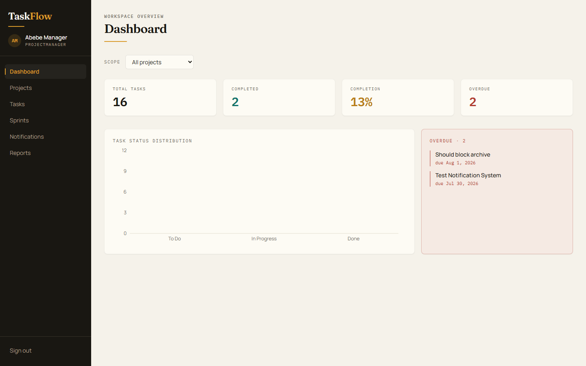

<div align="center">

# TaskFlow

### Full-stack project management platform — NestJS · Next.js · MongoDB

A production-ready task management system built end-to-end: role-based access control,
JWT session management, sprint planning with burndown analytics, automated notifications,
a full activity audit trail, and report generation — all wrapped in a 197-test suite.


**[🚀 Live Demo](https://discussion-upgrades-int-eleven.trycloudflare.com)** &nbsp;·&nbsp; **[API Docs](taskflow/docs/API-PARITY.md)** &nbsp;·&nbsp; **[SRS](taskflow/docs/03-software-requirements-specification.md)** &nbsp;·&nbsp; **[Deployment Guide](docs/DEPLOYMENT.md)**

---

### Seeded Accounts

The app opens straight into a demo session (no login page). These seeded
accounts exist in the database for API exploration and role switching.

| Role | Email | Password |
|---|---|---|
| 👑 **Administrator** | `liya@taskflow.dev` | `DemoPass123!` |
| 📋 **Project Manager** | `abebe@taskflow.dev` | `DemoPass123!` |
| 🧑‍💻 **Team Member** | `hanna@taskflow.dev` | `DemoPass123!` |

> ⚠️ The demo runs through a temporary Cloudflare tunnel from a local machine — it may be offline
> outside working hours. The backend API is at `https://lined-exp-submission-afford.trycloudflare.com/api`.
> Screenshots below are committed to the repo and always render: **[full gallery →](docs/SCREENSHOTS.md)**

</div>



---

## Why this project

TaskFlow is not a tutorial clone — it's a complete, spec-driven product built against a real
software requirements specification (SRS), with architecture diagrams, business rules, and an
audit trail that mirrors how commercial task management tools behave. It demonstrates:

- **Full-stack TypeScript** — one language across API, database models, and UI.
- **Secure-by-design auth** — HTTP-only cookies, JWT access + rotating refresh tokens, bcrypt hashing.
- **Defense in depth** — role guards, project-scoped access guards, input validation pipes, exception filters.
- **Real engineering process** — unit + e2e tests, CI pipeline, seeded demo data, deployment configs.

---

## ✨ Features

### Authentication & Authorization
- **JWT authentication** with HTTP-only cookies (XSS-resistant) and **rotating refresh tokens** (revocation on reuse)
- **RBAC** — `Administrator > ProjectManager > TeamMember` enforced by global guards
- **Project-scoped access** — members only see tasks/projects they belong to
- Deactivated users are locked out; password hashing via `bcrypt`

### Task Management
- Full task lifecycle: `Backlog → To Do → In Progress → In Review → Done → Archived` with **validated state transitions**
- Assignment to project members only, deadlines validated against project dates, priorities
- **Overdue detection** with automated 24-hour deadline-urgent alerts (cron-driven)

### Sprint Planning & Analytics
- Sprint lifecycle (`Planning → Active → Completed`) with task assignment to sprints
- **Burndown chart** computed from sprint history + completion dates
- Sprint start/completion notifications broadcast to project members

### Notifications & Activity
- Typed, actor-attributed notifications (task assigned, status changed, comment, deadline urgent, sprint events)
- Unread-count badge in the sidebar; deep links into the relevant task/sprint
- **Activity timeline** recording project & task events across modules

### Collaboration & Reporting
- Chronological, threaded **comments** with edit/delete audit
- **Report generation** (PM-only) — project status and performance summaries
- Teams management, user management with role assignment

### Frontend
- Next.js **App Router** with React 19 — 14 routes (dashboard, projects, tasks, sprints, notifications, reports, teams, users)
- Role-aware navigation & protected pages; dashboard with **Recharts** visualizations
- Responsive Tailwind design with a distinctive design system (Fraunces / Manrope / IBM Plex Mono)

---

## 🛠 Tech Stack

| Layer | Technology |
|---|---|
| **Language** | TypeScript (strict) |
| **Backend** | NestJS 11, Express, Passport.js |
| **Frontend** | Next.js 16 (App Router), React 19 |
| **Database** | MongoDB + Mongoose (ODM) |
| **Auth** | JWT (access + rotating refresh), bcrypt, HTTP-only cookies |
| **Real-time events** | @nestjs/event-emitter (cross-module notifications) |
| **Charts** | Recharts |
| **Styling** | Tailwind CSS |
| **Testing** | Jest (unit + e2e), mongodb-memory-server |
| **CI/CD** | GitHub Actions · Render (blueprint) · Vercel · Docker |

---

## 🏗 Architecture

```
┌─────────────────────────────┐      ┌──────────────────────────────┐
│         Browser             │      │      Next.js Frontend        │
│   (React 19 + Tailwind)     │──────▶   App Router / 14 routes     │
└─────────────────────────────┘      └──────────────┬───────────────┘
                                                    │  HTTPS + cookies
                                                    ▼
                             ┌──────────────────────────────┐
                             │       NestJS Backend         │
                             │  /api · global guards + pipes │
                             └──────┬──────────────┬────────┘
                                    │              │
                        ┌───────────▼──┐   ┌───────▼──────────┐
                        │  MongoDB     │   │ Event Bus        │
                        │  (Mongoose)  │   │ (notifications,  │
                        └──────────────┘   │  activity log)   │
                                           └──────────────────┘
```

The backend is organized as **11 feature modules** (`auth`, `users`, `teams`, `projects`, `tasks`,
`sprints`, `comments`, `notifications`, `activity`, `reports`, `health`) — each with its own
controller, service, repository, DTOs, and schema. Cross-cutting concerns live in `common/`
(guards, decorators, pipes, filters), `config/` (env-driven JWT config), and `database/`.

```
taskflow/
├── backend/            # NestJS API — 11 feature modules, 197 unit tests, e2e smoke tests
│   ├── src/
│   │   ├── common/     # RBAC guards, project-access guards, pipes, exception filter
│   │   ├── auth/       # JWT strategy, rotating refresh, HTTP-only cookie sessions
│   │   ├── tasks/      # Lifecycle state machine, deadline cron, sprint assignment
│   │   ├── sprints/    # Sprint lifecycle + burndown analytics
│   │   ├── notifications/  # Typed actor-attributed events, unread-count API
│   │   └── …           # users, teams, projects, comments, reports, activity, …
│   └── scripts/seed.ts # Idempotent demo-data seeder (npm run seed -- --demo)
├── frontend/           # Next.js App Router — dashboard, boards, reports
│   ├── app/            # 14 routes with role-aware navigation
│   ├── components/     # AppShell, Sidebar (unread badge), …
│   ├── contexts/       # AuthContext (session restore, login, logout)
│   └── lib/            # Axios client, API base URL via NEXT_PUBLIC_API_URL
├── docs/               # SRS, API parity matrix, deployment guide
├── diagrams/           # UML class/sequence/activity/state diagrams
└── render.yaml         # Render blueprint · vercel.json · Dockerfile
```

---

## ✅ Testing & Quality

- **197 unit tests / 19 suites** (backend) — services, repositories, guards, pipes, cron, listeners
- **E2E smoke tests** — real HTTP flows against a Nest test app with production guards + in-memory MongoDB
- **CI pipeline** (`.github/workflows/ci.yml`) — backend lint → tests → build → e2e; frontend lint → build
- **Type-safe everywhere** — DTOs with class-validator, strict validation pipes (whitelist + forbid non-whitelisted)

```bash
cd taskflow/backend && npm test              # 197 unit tests
cd taskflow/backend && npm run test:e2e      # e2e smoke tests
cd taskflow/frontend && npm run build        # production build (type-checks every route)
```

---

## 🚀 Getting Started

```bash
# 1. Install dependencies (npm workspaces monorepo)
cd taskflow && npm install

# 2. Configure environment (see backend/.env.example + frontend/.env.example)
cp backend/.env.example backend/.env
cp frontend/.env.example frontend/.env.local

# 3. Seed demo data (users + a demo project, sprint & tasks) — one command
cd backend && npm run seed:demo

# 4. Run both apps in two terminals
cd backend && npm run start:dev    # API → http://localhost:3001/api
cd frontend && npm run dev         # UI  → http://localhost:3000
```

Open **http://localhost:3000** — the workspace opens straight in with a
seeded demo session (no login page).

---

## 📚 Documentation

- **[Software Requirements Specification](taskflow/docs/03-software-requirements-specification.md)** — the spec this was built against
- **[API Parity Matrix](taskflow/docs/API-PARITY.md)** — endpoint ↔ requirement traceability
- **[Deployment Guide](docs/DEPLOYMENT.md)** — Vercel + Render + Fly.io, seeding, env vars, CI
- **[Screenshots](docs/SCREENSHOTS.md)** — UI captures of the dashboard, tasks, sprints, and projects
- **[Architecture Diagrams](taskflow/diagrams/)** — UML class, sequence, activity, state machine
- **[Engineering Notes](taskflow/docs/learning-notes/)** — module-by-module build journal
- **[Project Charter](taskflow/docs/02-project-charter.md)** & **[Client Request](taskflow/docs/01-Client-Request-Letter.md)**

---

## 🧑‍💻 About the Developer

This project was designed and built end-to-end as a **software engineering residency capstone** —
from requirements analysis (SRS) and UML modeling, through a spec-compliant NestJS API with
defense-in-depth security, to a polished Next.js frontend and production deployment tooling.

Questions, feedback, or a feature request? The demo has seeded data to explore — the app opens straight into a live workspace; click around. The seeded accounts listed above still exist in the database for API exploration / role switching.

---

<div align="center">

**Built with** TypeScript · NestJS · Next.js · MongoDB · Jest · Tailwind CSS

</div>
