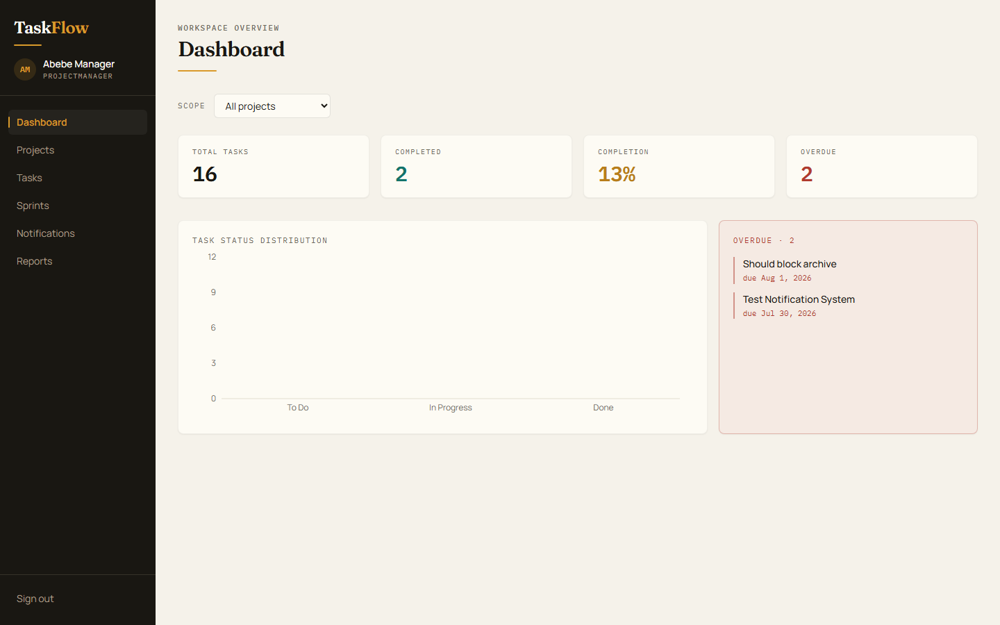
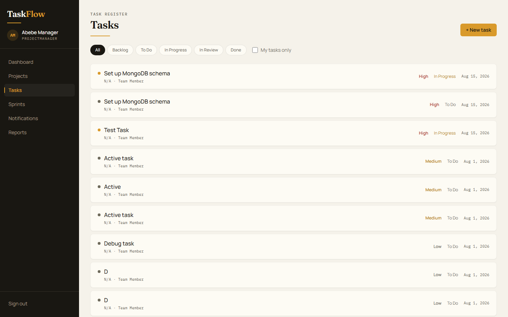
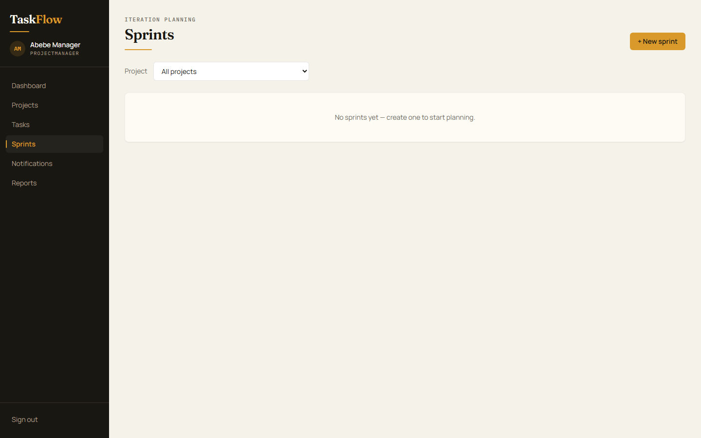
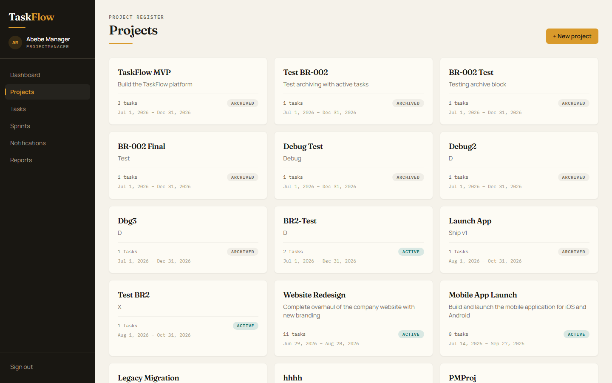

# TaskFlow — Screenshots

Real captures from the running application (seeded demo data). These live in the
repo so the UI is visible even when the temporary demo tunnel is offline.

> 🌐 Prefer a browsable page? The **hosted gallery** is always on at
> **<https://lilhop36.github.io/Taskflow/>** (deployed via GitHub Actions).

## Dashboard

The workspace overview — completion stats, task status distribution, and overdue
highlights for the selected project scope.

## Tasks

Task list with lifecycle status (`Backlog → To Do → In Progress → In Review → Done`),
priority, and filterable status columns.

## Sprints

Sprint planning board — lifecycle states, task assignment, and burndown analytics.

## Projects

Project portfolio view with status, membership, and archival state.

---

> ⚠️ **Demo availability:** the live demo runs through a temporary Cloudflare tunnel
> from a local machine and may be offline outside working hours. The screenshots
> above are committed to the repository and always render on GitHub.
